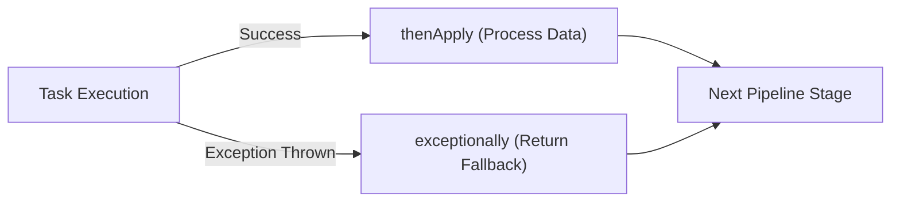

# ⚡ The Definitive Guide to CompletableFuture in Java

Welcome to the beginner-to-advanced guide on **`CompletableFuture<T>`** in Java.

`CompletableFuture` (introduced in Java 8 and enhanced in Java 9, 12, and 21) is Java’s premier tool for **Asynchronous, Non-Blocking, and Event-Driven Programming**.

---

## 📑 Table of Contents
1. [The Evolution: Why Did Java Need CompletableFuture?](#1-the-evolution-why-did-java-need-completablefuture)
2. [What is a CompletableFuture?](#2-what-is-a-completablefuture)
3. [The Core Mental Model](#3-the-core-mental-model)
4. [Mastering the API: Step-by-Step](#4-mastering-the-api-step-by-step)
   - [A. Creating CompletableFutures](#a-creating-completablefutures)
   - [B. Transforming & Chaining (thenApply, thenAccept, thenRun)](#b-transforming--chaining-thenapply-thenaccept-thenrun)
   - [C. Composing Dependent Futures (thenCompose / FlatMap)](#c-composing-dependent-futures-thencompose--flatmap)
   - [D. Combining Two Independent Futures (thenCombine)](#d-combining-two-independent-futures-thencombine)
   - [E. Racing Futures: Fastest Wins (acceptEither, applyToEither)](#e-racing-futures-fastest-wins-accepteither-applytoeither)
   - [F. Aggregating Multiple Futures (allOf, anyOf)](#f-aggregating-multiple-futures-allof-anyof)
   - [G. Exception Handling & Timeouts (exceptionally, handle, orTimeout)](#g-exception-handling--timeouts-exceptionally-handle-ortimeout)
5. [Async vs Non-Async Methods: Which Thread Runs What?](#5-async-vs-non-async-methods-which-thread-runs-what)
6. [CompletableFuture + Java 21 Virtual Threads Synergy](#6-completablefuture--java-21-virtual-threads-synergy)
7. [Cheat Sheet & Decision Tree](#7-cheat-sheet--decision-tree)

---

## 1. The Evolution: Why Did Java Need CompletableFuture?

To understand `CompletableFuture`, let's see how asynchronous programming evolved in Java:

```
Java 1.0 (1996) ──────► Thread & Runnable
                         ❌ No return values, manual thread management.

Java 5 (2004)   ──────► ExecutorService, Callable<V>, Future<V>
                         ❌ future.get() is completely BLOCKING!
                         ❌ Cannot chain callbacks ("when finished, do this").
                         ❌ Cannot combine multiple futures together.
                         ❌ No built-in exception handling pipeline.

Java 8 (2014)   ──────► CompletableFuture<T> (CompletionStage)
                         Non-blocking callbacks, functional chaining, combining,
                         racing, manual completion, and robust error handling!

Java 21+ (2023) ──────► CompletableFuture + Virtual Threads
                         Infinite concurrent asynchronous pipelines without thread pool exhaustion!
```

### The Big Flaw with Traditional `Future<T>`:
```java
// Traditional Java 5 Future:
Future<String> future = executor.submit(() -> callRemoteService());

// ❌ BLOCKING: The calling thread sits frozen and idle waiting for the result!
String result = future.get(); 
processResult(result);
```

With `CompletableFuture`, you **never block**. You declare **what to do next** when the result becomes available:
```java
// Non-blocking CompletableFuture:
CompletableFuture.supplyAsync(() -> callRemoteService())
    .thenApply(result -> processResult(result))
    .thenAccept(finalOutput -> System.out.println("Done: " + finalOutput));
```

---

## 2. What is a CompletableFuture?

`CompletableFuture<T>` implements two interfaces:
1. `Future<T>`: Represents a pending asynchronous computation result.
2. `CompletionStage<T>`: A promise that represents a single stage in a computation pipeline that can be chained with other stages.

### Why is it called "Completable"?
Because unlike a traditional `Future`, you can **manually complete it** from anywhere (e.g. from a WebSocket message, timer, or event listener):

```java
CompletableFuture<String> promise = new CompletableFuture<>();

// Thread A waits non-blockingly:
promise.thenAccept(msg -> System.out.println("Received: " + msg));

// Later, Thread B manually completes it:
promise.complete("Hello from Thread B!"); // Triggers Thread A's callback!
```

---

## 3. The Core Mental Model

Think of `CompletableFuture` like an **assembly line conveyor belt** in a factory:

```
[ supplyAsync ] ───► [ thenApply ] ───► [ thenApply ] ───► [ thenAccept ]
   Fetch User           Parse JSON         Enrich Data         Save to DB
   (Async Task)        (Transform)        (Transform)          (Consume)
```

Each stage:
- Waits for the previous stage to finish.
- Automatically receives the output of the previous stage.
- Executes without blocking the main application thread.

---

## 4. Mastering the API: Step-by-Step

### A. Creating CompletableFutures

```java
// 1. Task that RETURNS a value (Supplier<T>):
CompletableFuture<String> futureResult = CompletableFuture.supplyAsync(() -> {
    // Simulated I/O
    return "User #101";
}, executor);

// 2. Task that DOES NOT return a value (Runnable):
CompletableFuture<Void> futureAction = CompletableFuture.runAsync(() -> {
    System.out.println("Background logging task");
}, executor);

// 3. Pre-computed already completed future (useful for testing or cache hits):
CompletableFuture<String> cached = CompletableFuture.completedFuture("Cached Data");
```

---

### B. Transforming & Chaining (`thenApply`, `thenAccept`, `thenRun`)

These methods take the result of the previous stage and continue the pipeline:

| Method | Takes as Input | Returns | Equivalent In Streams |
| :--- | :--- | :--- | :--- |
| **`thenApply(Function<T, R>)`** | Previous Result $T$ | New Result $R$ | `.map()` |
| **`thenAccept(Consumer<T>)`** | Previous Result $T$ | `Void` (Consumes it) | `.forEach()` |
| **`thenRun(Runnable)`** | Nothing | `Void` (Action only) | Side effect |

```java
CompletableFuture.supplyAsync(() -> "42")               // 1. Supplier returns String "42"
    .thenApply(str -> Integer.parseInt(str))           // 2. Transform String -> Integer 42
    .thenApply(num -> num * 10)                        // 3. Transform Integer -> 420
    .thenAccept(result -> System.out.println(result))  // 4. Print 420
    .thenRun(() -> System.out.println("Pipeline finished!")); // 5. Final cleanup
```

---

### C. Composing Dependent Futures (`thenCompose` / FlatMap)

Use `thenCompose` when your callback itself returns **another `CompletableFuture`** (preventing nested `CompletableFuture<CompletableFuture<T>>`).

```
Scenario: Fetch User ID -> Then using User ID, Fetch User Orders
```

```java
// Method 1: Returns CompletableFuture<User>
CompletableFuture<User> getUser(String userId);

// Method 2: Returns CompletableFuture<List<Order>>
CompletableFuture<List<Order>> getOrders(User user);

// ❌ BAD: using thenApply creates nested CompletableFuture<CompletableFuture<List<Order>>>
CompletableFuture<CompletableFuture<List<Order>>> nested = 
    getUser("U-100").thenApply(user -> getOrders(user));

//  GOOD: thenCompose flattens it into CompletableFuture<List<Order>>
CompletableFuture<List<Order>> orders = 
    getUser("U-100").thenCompose(user -> getOrders(user));
```

---

### D. Combining Two Independent Futures (`thenCombine`)

Use `thenCombine` when you have **two independent asynchronous tasks running in parallel**, and you want to merge their results when **both** are done.

```
                  ┌──► Task A: Fetch Weather (runs parallel) ──┐
[ Start Request ]─┤                                            ├──► thenCombine (Merge into Dashboard)
                  └──► Task B: Fetch Traffic (runs parallel) ──┘
```

```java
CompletableFuture<String> weatherFuture = CompletableFuture.supplyAsync(() -> {
    return "Sunny, 25°C";
}, virtualThreadExecutor);

CompletableFuture<String> trafficFuture = CompletableFuture.supplyAsync(() -> {
    return "Light Traffic (15 min ETA)";
}, virtualThreadExecutor);

// Wait for BOTH to complete in parallel, then combine:
CompletableFuture<String> dashboardFuture = weatherFuture.thenCombine(trafficFuture, 
    (weather, traffic) -> {
        return "Dashboard: [Weather: " + weather + " | Traffic: " + traffic + "]";
    });
```

---

### E. Racing Futures: Fastest Wins (`acceptEither`, `applyToEither`)

Use `acceptEither` or `applyToEither` when you have **two redundant services** (e.g., Primary & Backup Payment Gateway, or US-East & US-West Cache), and you want to use the result of whichever responds first.

```java
CompletableFuture<String> primaryPayment = CompletableFuture.supplyAsync(() -> callStripe());
CompletableFuture<String> backupPayment  = CompletableFuture.supplyAsync(() -> callPayPal());

// Whoever finishes first wins; the slower result is ignored:
CompletableFuture<String> fastestPayment = primaryPayment.applyToEither(
    backupPayment, 
    fastestResult -> "Paid via: " + fastestResult
);
```

---

### F. Aggregating Multiple Futures (`allOf`, `anyOf`)

When you need to execute $N$ parallel tasks ($N > 2$):

#### 1. `CompletableFuture.allOf(f1, f2, f3, ...)` (Wait for ALL)
```java
CompletableFuture<String> f1 = CompletableFuture.supplyAsync(() -> fetchService1());
CompletableFuture<String> f2 = CompletableFuture.supplyAsync(() -> fetchService2());
CompletableFuture<String> f3 = CompletableFuture.supplyAsync(() -> fetchService3());

// Wait for all 3 to finish
CompletableFuture<Void> allFutures = CompletableFuture.allOf(f1, f2, f3);

// Extract results once all are finished:
CompletableFuture<List<String>> combined = allFutures.thenApply(v -> {
    return List.of(f1.join(), f2.join(), f3.join());
});
```

#### 2. `CompletableFuture.anyOf(f1, f2, f3, ...)` (Wait for ANY one)
Returns the result of the first future that completes (successfully or exceptionally).

---

### G. Exception Handling & Timeouts

In traditional code, you use `try / catch`. In `CompletableFuture`, you use functional error recovery stages:



#### 1. `exceptionally(Function<Throwable, T>)` - Fallback Value
Executes **only if** an exception was thrown earlier in the pipeline:
```java
CompletableFuture<String> userFuture = CompletableFuture.supplyAsync(() -> {
    if (databaseIsDown) throw new RuntimeException("DB Connection Timeout");
    return "User: Alice";
}).exceptionally(ex -> {
    System.err.println("Failed to fetch user: " + ex.getMessage());
    return "Guest User (Fallback)"; // Return safe default
});
```

#### 2. `handle(BiFunction<Result, Throwable, NewResult>)` - Always Executes
Executes whether the previous stage succeeded or failed:
```java
CompletableFuture<String> result = future.handle((data, ex) -> {
    if (ex != null) {
        return "Error occurred: " + ex.getMessage();
    }
    return "Success: " + data;
});
```

#### 3. Timeouts (Java 9+): `orTimeout` & `completeOnTimeout`
```java
CompletableFuture<String> future = CompletableFuture.supplyAsync(() -> slowRemoteCall())
    // Fails with TimeoutException if not finished within 2 seconds:
    .orTimeout(2, TimeUnit.SECONDS);

CompletableFuture<String> withFallback = CompletableFuture.supplyAsync(() -> slowRemoteCall())
    // Returns default value if not finished within 2 seconds:
    .completeOnTimeout("Default Fallback Response", 2, TimeUnit.SECONDS);
```

---

## 5. Async vs Non-Async Methods: Which Thread Runs What?

Every transformation method has 3 variants:
1. `thenApply(fn)`
2. `thenApplyAsync(fn)`
3. `thenApplyAsync(fn, executor)`

```java
CompletableFuture.supplyAsync(() -> fetchUser(), customExecutor)
    // 1. thenApply: Runs on the SAME thread that finished supplyAsync (or caller thread if already done)
    .thenApply(user -> enrich(user))
    
    // 2. thenApplyAsync(fn): Dispatches to ForkJoinPool.commonPool()
    .thenApplyAsync(user -> format(user))
    
    // 3. thenApplyAsync(fn, myExecutor): Dispatches to YOUR specified executor pool
    .thenApplyAsync(user -> save(user), virtualThreadExecutor);
```

---

## 6. CompletableFuture + Java 21 Virtual Threads Synergy

In Java 8 through 20, using `CompletableFuture.supplyAsync(task)` without specifying an executor used `ForkJoinPool.commonPool()`.
- The common pool is sized to CPU cores ($\approx 8$ threads).
- If your async tasks performed **blocking I/O** (e.g. database calls, HTTP), you would **exhaust the common pool** and freeze the entire JVM!

### The Java 21 Solution:
Pass a **Virtual Thread Executor** to `CompletableFuture`:

```java
ExecutorService vtExecutor = Executors.newVirtualThreadPerTaskExecutor();

// Now you can spawn 100,000 asynchronous CompletableFutures doing blocking I/O
// without ever running out of threads!
CompletableFuture<String> future = CompletableFuture.supplyAsync(() -> {
    // Blocking I/O unmounts virtual thread automatically!
    return restClient.get().uri(url).retrieve().body(String.class);
}, vtExecutor);
```

---

## 7. Cheat Sheet & Decision Tree

```
Do you want to:
├── Create an async task?
│   ├── Returns value   ──► CompletableFuture.supplyAsync(Supplier, executor)
│   └── No return value ──► CompletableFuture.runAsync(Runnable, executor)
│
├── Transform output (1:1)?
│   ├── Returns new value ──► .thenApply(Function)
│   ├── Consumes value    ──► .thenAccept(Consumer)
│   └── Side-effect only  ──► .thenRun(Runnable)
│
├── Chain dependent async calls?
│   └── Returns another Future ──► .thenCompose(Function) (FlatMap)
│
├── Combine two parallel futures?
│   ├── Wait for both & combine  ──► .thenCombine(futureB, BiFunction)
│   └── Wait for either (fastest)──► .applyToEither(futureB, Function)
│
├── Aggregate N futures?
│   ├── Wait for all ──► CompletableFuture.allOf(f1, f2, f3...)
│   └── Wait for any ──► CompletableFuture.anyOf(f1, f2, f3...)
│
└── Handle errors?
    ├── Provide fallback on error ──► .exceptionally(ex -> fallback)
    ├── Always handle result/error──► .handle((res, ex) -> ...)
    └── Enforce max time limit    ──► .orTimeout(2, TimeUnit.SECONDS)
```
